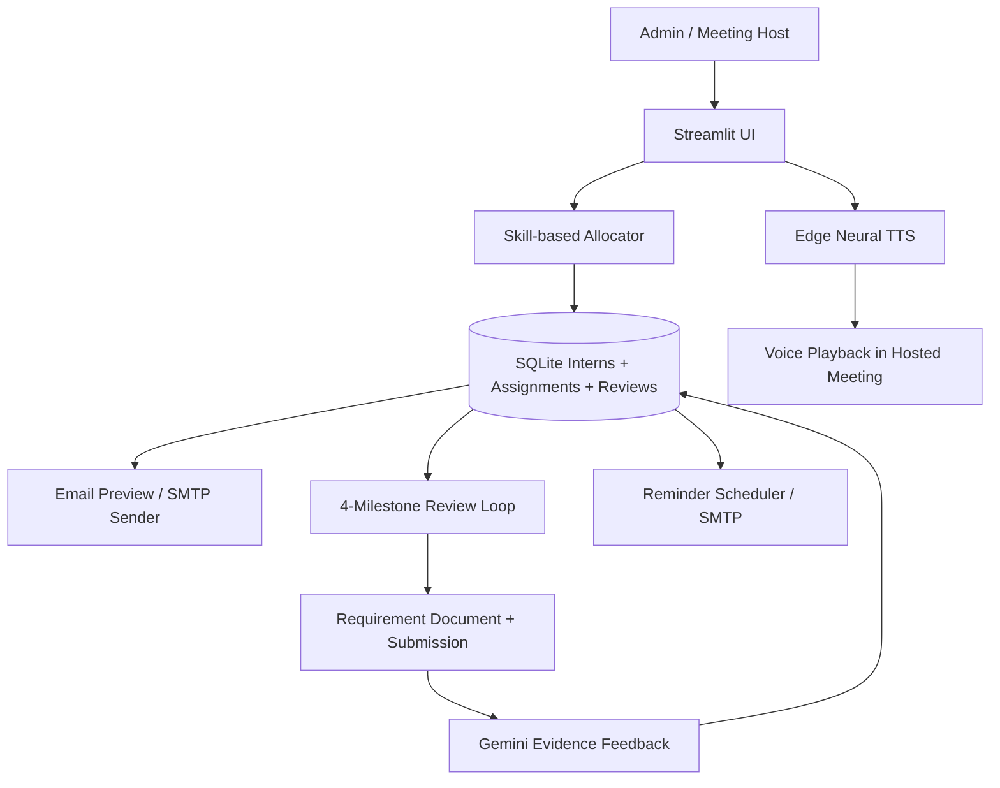

# 🎙️ InternFlow AI

**A multilingual, AI-assisted task allocation and milestone review copilot for internship coordinators.**  
**Assignment:** Shortfundly — Round 2 AI Engineer prototype.

## What this MVP demonstrates

| Requirement | MVP implementation |
| --- | --- |
| Assign tasks to 10+ interns | CSV import, skill-tag matching, workload balancing and chat command |
| Explain tasks through natural voices | Edge Neural TTS: English (India), Tamil, Hindi |
| Tamil-English / Hindi-English informal wording | Conversational script templates; optional Gemini localization |
| Send assignment instructions | SMTP email with task, submission format, 4 review dates, meeting link |
| 4 milestones per intern | Persisted reviews with editable dates, criteria and links |
| Remind interns before milestones | Bulk reminder email buttons; optional daily CLI scheduler |
| Compare company requirements and intern work | Text/PDF/DOCX input + evidence-oriented Gemini feedback |
| Send review feedback emails | Feedback preview, SMTP send, next milestone in email |
| Track progress | SQLite database, dashboard, review history and delivery log |

**IMPORTANT SCOPE:** The app **does not independently join or speak in Google Meet**. The meeting host may screen-share the voice assistant and play audio in the call. Google Meet integration needs a separate authorized integration; a Meeting URL can be attached to each milestone. PDFs are text-extracted, not OCR'd. The AI reviews submitted written evidence; it **does not run or verify code**.

## Setup (Windows / Python 3.10+)

```powershell
# In your extracted InternFlowAI folder
py -m venv .venv
.venv\Scripts\activate
pip install -r requirements.txt
streamlit run app.py
```

If `py` is not recognized, try `python -m venv .venv` and `python -m streamlit run app.py`.

Your browser should open `http://localhost:8501`.

### Gemini API (optional but recommended for Round 2)

1. Generate an API key from [Google AI Studio](https://aistudio.google.com/apikey).
2. In the sidebar, paste **Gemini API key**. Set a supported model, default `gemini-2.5-flash`.
3. Go to **Review Studio** to generate AI feedback. Without the key, only a clearly labelled **keyword checklist** is shown. This is not claimed as AI feedback.
4. The model may be unavailable or rate-limited depending on your API access. Choose a supported model in sidebar if needed.

**Security:** Use sidebar fields or create `.env` from `.env.example`. Never commit `.env`, passwords or API keys.

### Actual Gmail SMTP sending (optional)

1. Set `SMTP_EMAIL` and `SMTP_APP_PASSWORD` in sidebar or `.env`.
2. Personal Gmail may support [app passwords](https://support.google.com/mail/answer/185833) after enabling 2-Step Verification. Not every organization account supports this.
3. Test with an address you own. **Example addresses (`example.com`) in demo data cannot receive mail.**
4. Click `Send real email`. Only *successful sends* are logged and duplicates are blocked by a unique notification key.

Emails can also be previewed without any credentials. Previewing is NOT sending.

## Quick demo flow (2 minutes)

1. **Dashboard** → `Load sample demo data` (4 fictional interns + 3 task templates).
2. **Chat Assistant** → type `allocate tasks`; ask `When is Meena review?` to show grounded chatbot responses.
3. **Task Allocation** → view automatically assigned tasks (or allocate here instead of chat) → preview assignment email.
4. **Voice Assistant** → select intern → Tamil, Hindi or English → `Generate natural voice` → play audio.
5. **Review Studio** → select intern → Review 1 → see milestone → paste sample requirements and progress (or upload included sample `.txt`) → `Analyze submission vs company requirements`. Provide Gemini key for real AI analysis.
6. Open saved feedback, show next milestone and email preview; repeat for Review 2–4.
7. **Notifications** → show pending review reminders and email dispatch options.
8. **Dashboard** → show review completion progress.

**Important demo convenience:** The `sample_interns.csv` and `sample_tasks.csv` files show how to bulk import 10+ real intern records. The built-in sample has 4 records, to keep the video short.

## Architecture



## Review logic

- Each intern has **one assignment** and **four persisted review rows** with scheduled dates.
- The reviews are separate records, not just a hard-coded display. You can edit each milestone/date/link.
- A reviewer can supply company requirements and the intern's written progress evidence.
- Gemini returns a score only when supported by evidence, lists completed items, unverified gaps and action items. This is assistive, not a final hiring/performance decision.
- The feedback is persisted; the next review date appears in the email. Review 2–4 follow the same workflow.
- If AI credentials are missing, the app provides a **non-AI heuristic preview**, explicitly labelled as such.

## Scheduled reminders (optional enhancement)

Run in preview mode:

```powershell
python scheduler.py --days 2
```

To send *actual* reminders for milestones within the next two days:

```powershell
python scheduler.py --days 2 --send
```

You can run this command each morning from **Windows Task Scheduler** / Linux cron. Notifications use a unique reminder key so each review receives at most one logged reminder. **The Streamlit UI alone does not automatically send emails while closed.**

## Tests

```powershell
python -m unittest -v test_core.py
```

The tests cover skill matching, 4-review creation, repeated assignment safety, review persistence, notification deduplication and multilingual messages.

## GitHub upload

```powershell
git init
git add .
git commit -m "Build InternFlow AI multilingual task allocation and review prototype"
git branch -M main
git remote add origin https://github.com/YOUR_USERNAME/InternFlowAI.git
git push -u origin main
```

First create the empty `InternFlowAI` repository on GitHub. Replace `YOUR_USERNAME`. If Git refuses the commit, configure `git config --global user.name` and `git config --global user.email`. **Before pushing, confirm `.env` and `internflow.db` do NOT appear in `git status`.**

## Deployment notes

- For the deadline, **local demonstration and a recorded demo video** are recommended; avoid rushing OAuth and deployment setup.
- Streamlit Community Cloud's filesystem can be ephemeral. For production, move SQLite to a managed database and add accounts/roles and a real mail queue.
- Real Google Meet bot participation, autonomous meeting audio, recurring cloud jobs, true speech-to-speech conversation, OCR, code execution, reviewer approval workflows and scalable multi-user security are future work.

## Project files

- `app.py` — Streamlit UI, chat interface and interactions
- `core.py` — DB, allocation, review loop, Gemini feedback and localization
- `services.py` — Edge voice audio and SMTP delivery
- `scheduler.py` — optional reminder sender for cron / Windows Task Scheduler
- `test_core.py` — workflow unit tests
- `sample_*.csv` — bulk import examples
- `DEMO_SCRIPT.md` — ready-to-read recording script
- `.env.example` — local configuration template

**Data note:** Use fictional sample interns for the screen recording. All demo names and inboxes are placeholders.
